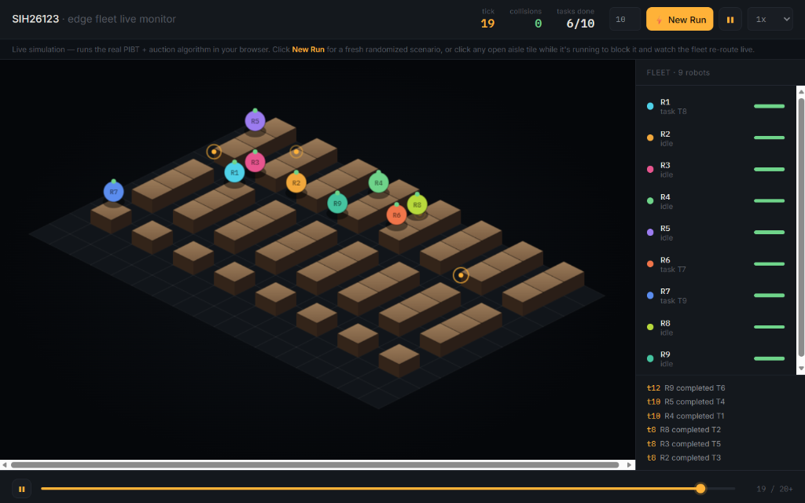
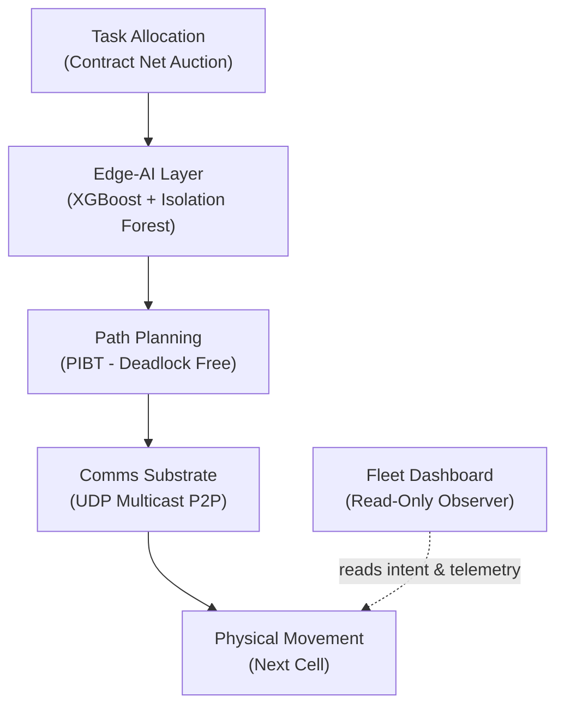

# SIH26123 — Edge-AI Distributed Fleet Coordination for Warehouse AMRs


<p align="center">
  
</p>

**Problem statement:** [SIH26123](https://sih.gov.in) — Bharat Electronics Limited — Smart Automation

A fully decentralized coordination and collision-avoidance framework for a multi-robot warehouse fleet. **No cloud, no central dispatcher, no single point of failure.** Every robot plans, negotiates, and bids for tasks independently, communicating peer-to-peer with its neighbors. 

Designed for deployment in air-gapped, RF-degraded environments (military depots, hazardous-material warehouses) where cloud connectivity cannot be assumed and collision safety is non-negotiable.

---

## 🏗️ System Architecture

Our solution utilizes a three-layer per-robot software stack. There is no central server; this exact stack runs independently on every edge device in the fleet.



### Core Components
1. **Peer-to-Peer Comms:** UDP Multicast (zero central brokers). Robots broadcast state and intent to immediate neighbors.
2. **PIBT Conflict Resolution:** Localized, deadlock-free path negotiation. If two robots want the same cell, Priority Inheritance with Backtracking (Okumura, IJCAI 2019) guarantees mathematical resolution in real-time.
3. **Edge-AI Predictive Layer:** On-device XGBoost (congestion prediction) & Isolation Forest (hardware anomaly detection) running in under 2ms on standard ARM Cortex CPUs.

See [`docs/PS_MAPPING.md`](docs/PS_MAPPING.md) for the line-by-line mapping from the official problem statement to our implementation. See [`ARCHITECTURE.md`](ARCHITECTURE.md) for the full system design.

---

## 🚀 Core Features & Benchmarks

The Problem Statement demands **zero collisions** and a **≥20% improvement** over traditional stop-and-wait baseline methods. 

We evaluated our PIBT stack against the baseline using a reproducible Python benchmark script (capped at 300 ticks).

| Scenario | Stop-and-Wait (Baseline) | Our PIBT + Edge-AI Stack | Improvement |
| :--- | :--- | :--- | :--- |
| **No Contention** (Control) | 10 Ticks | 10 Ticks | 0% (Honest baseline) |
| **Head-on Choke Point** | DNF (Deadlocked) | 10 Ticks (0 Collisions) | **$\ge 96.7\%$** |
| **Multi-Agent Narrow Aisle** | DNF (Deadlocked) | 20 Ticks (0 Collisions) | **$\ge 93.3\%$** |

*   **Zero Collisions:** Verified programmatically on every tick across 23 automated tests.
*   **True Resilience:** If a robot's hardware fails or it loses Wi-Fi connection, the fleet dynamically routes around it within 2 seconds. The system cannot be brought down by a single point of failure.

---

## 🛠️ Quick Start

```bash
pip install -r requirements.txt
python scripts/train_edge_ai.py              # Train the Edge-AI models (~80KB total)
python -m pytest tests/ -v                   # Run the full test suite (23/23 tests passing)
python scripts/run_demo.py                   # Headless demo, 3 agents on the default map
python benchmark/stop_and_wait_baseline.py   # Reproduce docs/BENCHMARK_RESULTS.md

# To run the true decentralized P2P demo (3 processes over UDP multicast):
python scripts/run_distributed_demo.py --kill-robot  # Kills Robot 2 live to prove resilience
```

To see the live Pygame dashboard (requires a display):
```python
from fleet.grid import WarehouseGrid
from fleet.agent import Agent
from fleet.sim.engine import SimulationEngine
from fleet.dashboard import render_pygame

grid = WarehouseGrid.default()
agents = [Agent("a1", (0,0), (9,8)), Agent("a2", (9,0), (0,8)), Agent("a3", (4,0), (4,8))]
engine = SimulationEngine(grid, agents, mode="pibt")
render_pygame.run(grid, engine)
```

---

## 🌐 Visual Demo (Live, Shareable, No Install)

`visuals/warehouse_demo.html` runs the real fleet algorithm **live, in the browser** — not a replay of a fixed recording. 

Click **New Run** for a fresh randomized scenario (6-10 robots), or **click any open aisle tile while it's running to block it** and watch the fleet re-route on the spot. Just open the file in any browser, nothing to install.

This is a JS port of the core simulation (`visuals/fleet_sim.js`), verified independently against the same scenarios the Python test suite covers:
```bash
node visuals/verify_js_port.js      # Standalone check, no browser needed
```
*(Note: The Python implementation remains the sole tested source behind every benchmark and PPT claim — the JS port exists only to drive this interactive demo).*

---

## 📂 Repository Layout

```text
src/fleet/
  grid.py                    Warehouse map (narrow aisles + choke points)
  agent.py                   Per-robot state (position, battery, task, priority)
  planning/
    astar.py                 Single-agent pathfinding
    pibt.py                  Multi-agent conflict resolution (PIBT)
  edge_ai/
    congestion_predictor.py  XGBoost aisle congestion prediction
    anomaly_detector.py      Isolation Forest robot health monitoring
  comms/
    p2p.py                   Decentralized UDP multicast peer messaging
  allocation/
    auction.py               Decentralized Contract Net task bidding
  sim/
    engine.py                Tick-based simulation engine
  dashboard/
    render_pygame.py         Read-only fleet monitoring UI
tests/                       23/23 passing pytest suite
scripts/
  run_demo.py                Headless entry point
  run_distributed_demo.py    Multi-process P2P demo (Live resilience test)
benchmark/                   Stop-and-wait baseline vs PIBT comparison
docs/
  PS_MAPPING.md              Requirement -> implementation traceability
  DEV_LOG.md                 Detailed development & decision log
  JUDGE_QA.md                Scripted answers to expected BEL judge questions
  SIH_Idea_PPT.html          Official 6-slide SIH presentation
  VIDEO_SCRIPT.md            Timestamped script for the demo video
```
